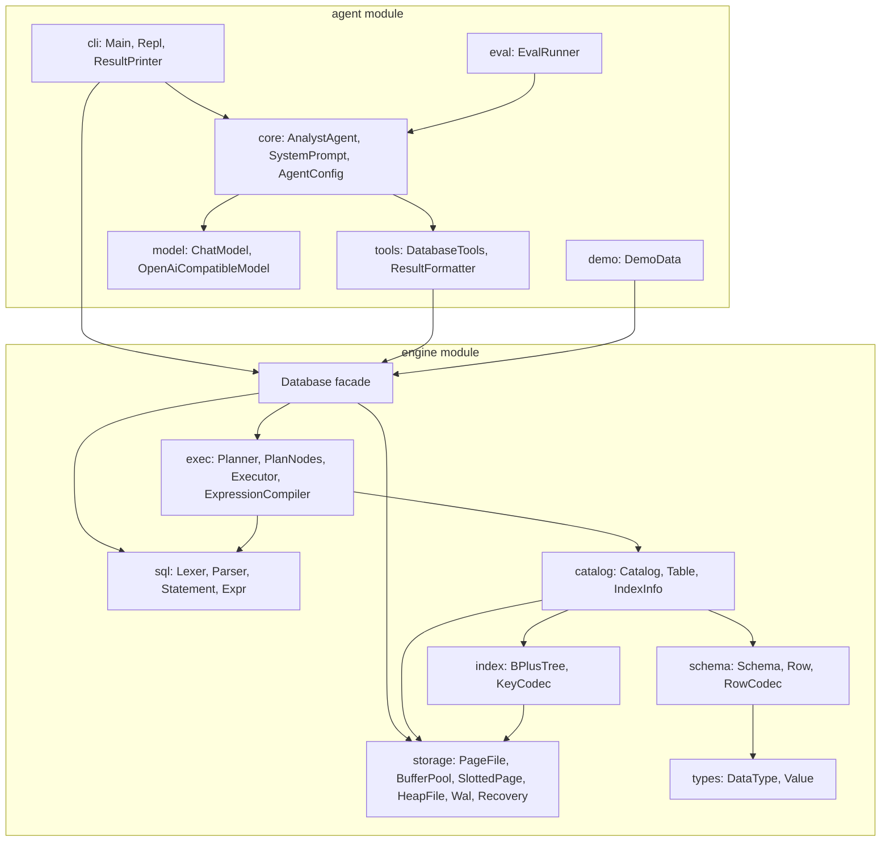
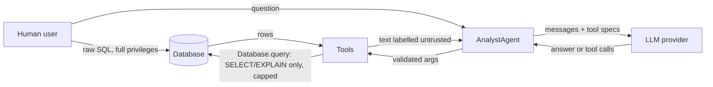

# 02 - System Architecture

## Module view

```
frierendb-parent (pom)
├── engine   no runtime dependencies
└── agent    depends on engine + Jackson; tests also use the engine's test-jar
```

The dependency points one way: **agent → engine**. The engine knows nothing about LLMs. The agent reaches the engine through the public `Database` class and the value types it exchanges with it (`QueryOptions`, `QueryResult`, `Schema`, `Column`, `FrierenException`); it never touches storage, the catalog or the planner.

## Layered view



Each box depends only on boxes below or beside it in the diagram; there are no cycles.

## Engine layers, bottom up

| Layer | Package | Responsibility | Knows about |
|---|---|---|---|
| Values | `types` | Typed values, SQL `NULL`, total ordering | nothing |
| Rows | `schema` | Column definitions, row validation, binary encoding | `types` |
| Pages | `storage` | Fixed-size file I/O, caching, record placement, the write-ahead log, transactions and recovery | bytes only |
| Indexes | `index` | Persistent B+ tree from key to record id | `storage`, `types` |
| Tables | `catalog` | Named tables and their indexes, persistence of definitions | `schema`, `storage`, `index` |
| Language | `sql` | Text to a syntax tree | `types` |
| Execution | `exec` | Tree to operators to results; semantics of NULL, limits | all of the above |
| Facade | `Database` | One thread-safe entry point; recovery on open; transaction control | `storage`, `catalog`, `sql`, `exec` |

Note the clean split: **storage knows nothing about schemas** (it moves byte arrays), and **the SQL parser knows nothing about tables** (it produces an unresolved tree). Name resolution and type checks happen later, in the planner and compiler.

## Agent layers

| Layer | Package | Responsibility |
|---|---|---|
| Provider | `model` | Message types, the `ChatModel` interface, one HTTP implementation |
| Capabilities | `tools` | The four tools; argument validation; result formatting |
| Orchestration | `core` | System prompt, loop, retries, limits, trace |
| Interface | `cli` | REPL; env-based configuration; human-readable trace |
| Quality | `eval` | Reference-query scoring |
| Sample data | `demo` + `resources/demo/university.sql` | Seed dataset |

## Trust boundaries



Three things are untrusted: the **model output**, the **tool arguments** that come from it, and the **data** returned from the database (it may contain text that looks like instructions). The only trusted component on the model side is the tool layer, which enforces limits itself. Details in [`05-safety-model.md`](05-safety-model.md).

## Files on disk

A database is a directory:

```
<db-dir>/
  catalog.bin        table and index definitions (atomic replace)
  <table>.tbl        one file per table, a sequence of 4096-byte pages
  <table>.<index>.idx  one B+ tree file per index, 4096-byte pages
  wal.log            write-ahead log: page images of recent transactions
```

Byte-level layouts are in [`../lld/03-on-disk-formats.md`](../lld/03-on-disk-formats.md).

## Concurrency model

- `Database` methods are `synchronized`: one statement at a time, one session.
- At most one transaction is open (`BufferPool` holds a single transaction id). There are no locks and no isolation: a read-only `query` made while a transaction is open sees its uncommitted changes.
- `BufferPool`, `PageFile`, `HeapFile` and `Catalog` are also synchronized per method so they stay consistent if used directly.
- Agent runs are synchronous and single-threaded; the HTTP client call blocks with a timeout.

## Build artefacts

- `engine` produces a jar and a **test-jar** (shared fixtures such as `TestDatabases`) used by the agent's tests.
- The CLI is `dev.frierendb.agent.cli.Main`; there is no fat jar yet, so it runs from class directories plus Jackson jars (see the root README).
