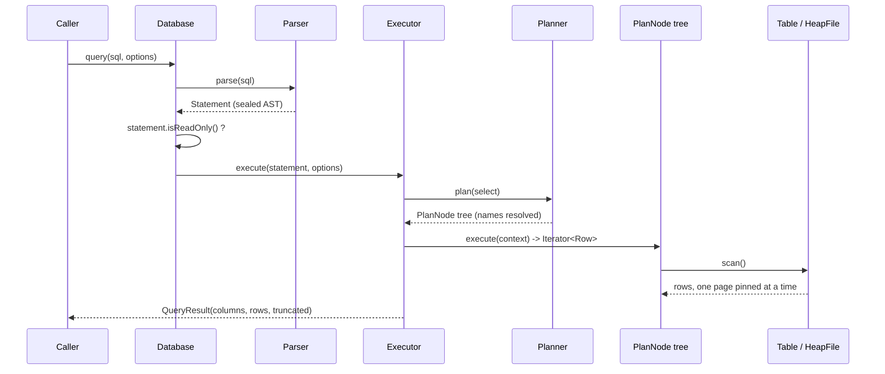
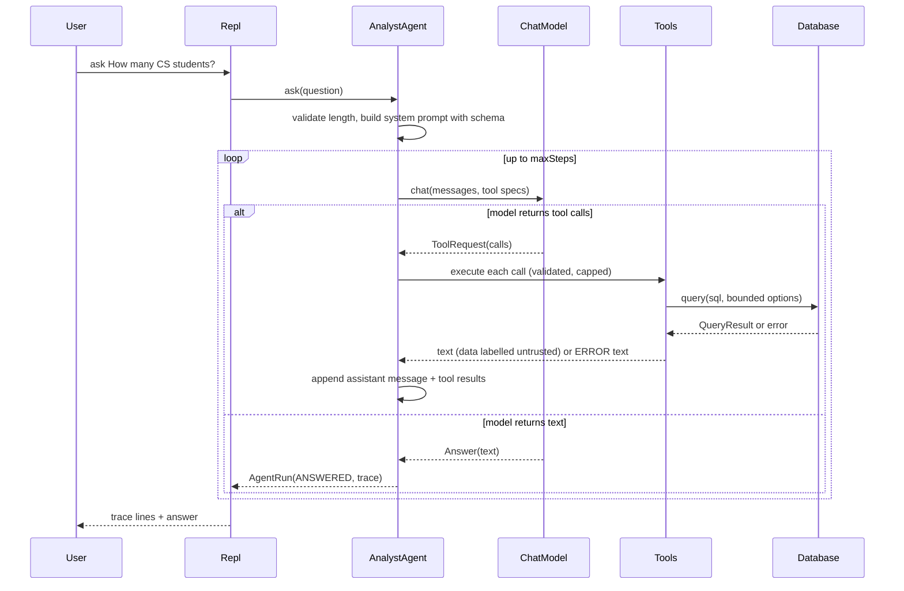

# 03 - Runtime Flows

Three flows cover almost everything the system does.

## Flow 1: a `SELECT`

Steps in words:

1. `Database.query` parses the text. A second statement after `;` is a parse error.
2. If the statement is not `SELECT`/`EXPLAIN`, `ReadOnlyViolationException` is thrown. This check is on the parsed object, so it cannot disagree with what would run.
3. The `Planner` resolves names against the catalog and builds a tree of operators. If the `WHERE` clause has a usable comparison on an indexed column of the `FROM` table, the scan becomes an `IndexScan` over that key range; the full `WHERE` is still applied above it ([`07-indexes-and-index-aware-planning.md`](07-indexes-and-index-aware-planning.md)).
4. The executor pulls rows from the root iterator until it has `maxRows` rows or the input ends. If more rows exist, `truncated = true`.
5. Along the way, scans call `context.tick()` (deadline check) and blocking operators call `context.materialize(n)` (memory cap).

## Flow 2: an `INSERT`

1. Parse into `Statement.Insert` (table, optional column list, one or more value rows).
2. Look up the table; compute which schema column each value goes to.
3. Evaluate each value expression with an empty input row (only constants and constant expressions are legal).
4. `Schema.conform` checks arity, `NOT NULL`, and types (an `INT` may widen to `DOUBLE`).
5. **Only after every row validated**, rows are encoded (`RowCodec`) and inserted into the heap file. A bad row in a multi-row insert means nothing is written.
6. The statement runs inside a transaction (an automatic one unless the user said `BEGIN`). Each changed page, with its before and after image, goes to `wal.log`; on commit the log is forced to disk, so the change is durable when the call returns. Data pages are written later (eviction or checkpoint). If anything fails, the transaction is rolled back and the table and its indexes are as they were. See [`08-transactions-and-recovery.md`](08-transactions-and-recovery.md).
7. If the table has indexes, every inserted row also adds an entry to each index (`NULL` keys are skipped). Oversized `TEXT` keys are rejected in step 5, before any write.

`UPDATE` and `DELETE` first collect all matching rows (a snapshot, using an index when the `WHERE` allows), then apply changes, so a statement never sees its own writes.

### Crash and recovery in one paragraph

On `Database.open`, before any file is opened, `Recovery.recover` reads `wal.log`: it redoes the after-images of committed transactions, undoes the before-images of unfinished ones, syncs, and empties the log. The result is the state after the last commit, whatever the crash interrupted.

## Flow 3: `ask <question>`

Exit conditions of the loop (each produces an `AgentRun` with a status):

| Status | Cause |
|---|---|
| `ANSWERED` | The model replied with text and no tool calls |
| `STEP_LIMIT` | `maxSteps` iterations without a final answer |
| `TIMEOUT` | `maxRunTime` elapsed (checked before each model call) |
| `MODEL_FAILED` | A permanent model error, or retries exhausted |

Model errors that are marked *retryable* (HTTP 429/5xx, network errors, malformed tool arguments, empty answers) are retried with exponential backoff (`retryBackoff × 2^attempt`) up to `modelRetries` times.

## Flow 4 (support): evaluation

`--eval` loads `eval/university-questions.json`, and for each question: runs the reference SQL to get the expected values; runs the agent; takes the **last successful `run_query`** from the trace; re-runs that SQL unmodified (unlimited options); compares values (rows sorted unless the reference has `ORDER BY`; numbers formatted to 4 decimals). See [`../build-guide/19-cli-demo-and-eval.md`](../build-guide/19-cli-demo-and-eval.md).

## Failure behaviour at a glance

| Situation | Result |
|---|---|
| SQL syntax or semantic error from the human | `Error: <message>` printed, REPL continues |
| SQL error from the model's query | `ERROR: <message>` returned to the model as the tool result; it can retry |
| Unknown tool or malformed arguments | `ERROR: ...` tool result; no crash |
| More tool calls than allowed in a step | Extra calls get an `ERROR` result (every call must get a result) |
| Tool output too long | Cut to `maxToolOutputChars` plus `[output truncated]` |
| Runaway query | `QueryLimitException` (time or memory) becomes a tool error |
| Unexpected `RuntimeException` in a tool | Generic error to the model; details only in the trace |
