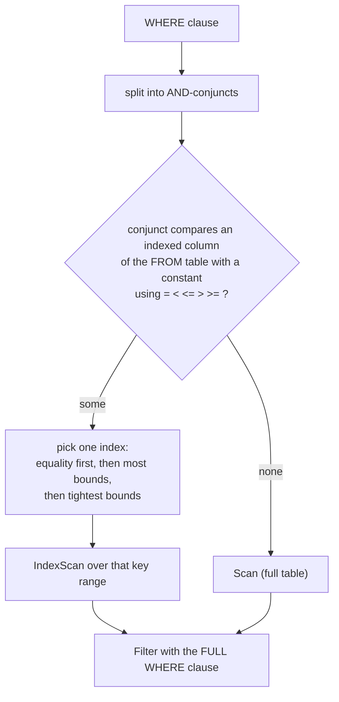

# 07 - Indexes and Index-Aware Planning

FrierenDB has secondary indexes: a persistent B+ tree on one column, which the planner uses to avoid reading a whole table when a `WHERE` clause pins down a key or a key range.

## What the user sees

```sql
CREATE INDEX idx_major ON students (major);
EXPLAIN SELECT name FROM students WHERE major = 'CS';
DROP INDEX idx_major;
```

```
Project [name]
  Filter (major = 'CS')
    IndexScan students using idx_major (major = 'CS')
```

- `CREATE INDEX [IF NOT EXISTS] name ON table (column)` builds the index from the rows already in the table. `DROP INDEX [IF EXISTS] name` removes it.
- Index names are unique across the whole database and case-insensitive.
- Every `INSERT`, `UPDATE` and `DELETE` keeps all of the table's indexes in step.
- Results never depend on whether an index exists. Only speed and row order of an unordered result can differ.

## Scope (what an index is, and is not)

| Property | Value |
|---|---|
| Columns | exactly one per index |
| Uniqueness | not unique: duplicate keys are allowed, every entry is `(key, row id)` |
| `NULL` | not indexed (a `NULL` key is skipped) |
| Key types | `INT`, `DOUBLE`, `BOOLEAN`, `TEXT` (TEXT keys at most 255 UTF-8 bytes) |
| Planner | rule-based, no statistics |
| Deletion | removes the entry but never merges or rebalances nodes |

## How the planner decides



The most important rule: **the whole `WHERE` clause is always evaluated again above the scan.** The index only decides which rows are *read*; it never decides which rows are *kept*. If the index range were too wide the answer would still be right, and if the planner cannot be sure it falls back to a full scan. The cases that fall back are:

- the constant is `NULL`, or evaluating it throws (the scan will then report the same error the user would have seen anyway);
- the constant's type does not match the column (for example `text_col = 5`);
- an `INT` constant outside ±2^53 compared with a `DOUBLE` column (it cannot be converted exactly);
- the column is inside an expression such as `LOWER(major) = 'cs'` or `v + 0 = 3` (this is the trick the tests use to force a scan).

Additional limits, stated plainly:

- Only the `FROM` table is narrowed. A column of a joined table is never used, so `LEFT JOIN` stays correct.
- `OR`, `IN`, `LIKE`, `NOT ...` and `<>` conditions are never used for an index; they are evaluated by the filter. `a BETWEEN x AND y` is rewritten by the parser into `a >= x AND a <= y`, so it can use an index.
- `ORDER BY` does not use index order; an `IndexScan` returns rows in key order, but a `Sort` is still planned when the query asks for ordering.
- `UPDATE` and `DELETE` use the same choice to find their rows.

## Failure behaviour

- If a row cannot be indexed (a `TEXT` value over 255 bytes in an indexed column), the statement fails **before any row is written**. The executor checks every prepared row first, and the transaction layer (see [08](08-transactions-and-recovery.md)) undoes anything that still slipped through.
- A failed `CREATE INDEX` removes its half-built file.
- Dropping a table drops its indexes; the catalog is saved before files are deleted so a crash leaves at worst an orphaned file, never a catalog entry without a file.

## Where to read more

- Algorithm and byte layout: [`../lld/08-index-internals.md`](../lld/08-index-internals.md), [`../lld/03-on-disk-formats.md`](../lld/03-on-disk-formats.md).
- Build it by hand: [`../build-guide/20-bplus-tree.md`](../build-guide/20-bplus-tree.md), [`21-indexes-sql-and-planning.md`](../build-guide/21-indexes-sql-and-planning.md).
- Real `EXPLAIN` output: [`../lld/06-explain-examples.md`](../lld/06-explain-examples.md).
