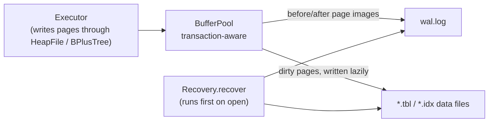

# 08 - Transactions and Crash Recovery

FrierenDB has a write-ahead log (WAL) and transactions. The goals, in plain terms:

1. **Atomic statements.** An `INSERT`, `UPDATE` or `DELETE` either happens completely or not at all, even when it fails half-way or the process is killed.
2. **Durable commits.** Once a statement or `COMMIT` returns, its changes survive a crash.
3. **Explicit transactions.** `BEGIN ... COMMIT` groups statements; `ROLLBACK` throws them away.

## What the user sees

```sql
BEGIN;
UPDATE accounts SET balance = balance - 50 WHERE id = 1;
UPDATE accounts SET balance = balance + 50 WHERE id = 2;
COMMIT;            -- both changes become durable together (or ROLLBACK to drop both)
```

| Situation | Behaviour |
|---|---|
| A lone `INSERT`/`UPDATE`/`DELETE` | Runs in its own transaction, committed automatically; undone if it throws |
| `BEGIN` while one is open, or `COMMIT`/`ROLLBACK` with none open | `TransactionException`; the open transaction is unaffected |
| A statement fails **without** having changed anything (e.g. unknown column) | The transaction stays open |
| A statement fails **after** changing data inside a transaction | The **whole transaction is rolled back** and a `TransactionException` is thrown, because half a statement cannot be separated from the rest |
| `CREATE`/`DROP` (table or index) inside a transaction | Refused with `TransactionException`; schema changes are not transactional |
| Process killed mid-transaction | On the next `Database.open` the transaction is undone |
| `close()` with a transaction open | The transaction is rolled back |
| `Database.query` (the agent's door) with `BEGIN`/`COMMIT`/`ROLLBACK` | `ReadOnlyViolationException`, like any other non-`SELECT` |

## The design in one page



- **Physical, page-level logging.** The log records whole 4096-byte page images, a *before* image and an *after* image. This makes recovery trivial to reason about (no logical undo) at the price of a large log.
- **Steal, no-force.** The buffer pool may write an *uncommitted* page to disk when it needs the frame (steal), and it does not write data pages at commit (no-force). Both are safe because of the log:
  - *Write-ahead rule*: before an uncommitted page reaches its data file, its record is already in the log and forced to disk. So an unfinished transaction can always be undone.
  - *Commit rule*: `COMMIT` appends a commit record and forces the log. Only then does the statement return. So a committed transaction can always be redone.
- **Recovery** runs before any data file is opened: redo committed transactions' after-images in log order, then undo unfinished transactions' before-images newest-first, then sync and empty the log. It is idempotent, so a crash during recovery is harmless.
- **Checkpoint**: write every dirty page, sync, and empty the log. It happens when the log passes a threshold after a commit (default 4 MiB), before any `CREATE`/`DROP`, and on `close`.

## Why each piece exists

| Mechanism | Prevents |
|---|---|
| Before-image in the log | A stolen, uncommitted page surviving a crash |
| After-image in the log + forced commit | Losing a commit because data pages were never written |
| Log frame checksum (CRC-32) and length | Treating a half-written log tail as real; the valid prefix ends at the first bad frame |
| Log entry written *before* the file grows | An orphan page left behind by a crash between growing the file and logging it |
| Catalog and heap free-space reload after rollback | A stale in-memory cache pointing at pages the rollback removed |
| Pre-validation in the executor | Most failures; they happen before the first write so there is nothing to undo |

## A real crash, reproduced

This was run against the demo database, using the CLI and `kill -9` (output abbreviated). The CLI was fed one auto-committed `UPDATE`, then `BEGIN` and a `DELETE`, and the process was killed while the transaction was still open:

```
UPDATE courses SET title = 'CRASH-TEST'      -- committed
BEGIN
DELETE FROM students                         -- never committed; kill -9 here
```

State on disk right after the kill:

- `courses.tbl` still held the *old* titles (`strings` showed `Art History`, `Painting Basics`): the commit forced only the log.
- `wal.log` was 8252 bytes: the 8-byte header, one UPDATE frame of 8219 payload bytes (`0x0000201b`: type, transaction id, `courses.tbl`, page 0, a 4096-byte before image and a 4096-byte after image), and a 9-byte COMMIT frame.

Reopening the same directory in the CLI: `SELECT title FROM courses` returned `CRASH-TEST` (redone from the log), `SELECT COUNT(*) FROM students` returned `20` (the open transaction left no effect), and `wal.log` was back to 8 bytes. Because the pool was large, the uncommitted `DELETE` never reached disk at all; the unit and crash tests use tiny pools to force uncommitted pages onto disk and check that they are undone.

## Honest limitations

- **One session, one transaction.** `Database` is synchronized and there is a single open transaction at a time. There is no locking, no isolation levels and no concurrency control. A read-only `query` made while a transaction is open **sees its uncommitted changes**.
- **Schema changes are not transactional.** `CREATE`/`DROP` run on their own, after a checkpoint, and cannot be rolled back.
- **The log is bulky**: up to two full pages per changed page per transaction.
- **No point-in-time recovery, no replication, no backups.** The log is a crash-recovery tool only.
- **The tests simulate crashes by copying a live database directory**, which models lost data pages and a forced log. They do not model a disk that reorders or loses *forced* writes, or a torn write inside a single 4 KiB page.
- **Performance** has not been benchmarked, so no figures are claimed. The only observation is that the full test suite got faster after the change because commit now syncs one log instead of every data file after every statement.

## Where to read more

- Algorithms, record format, recovery steps: [`../lld/09-wal-and-recovery-internals.md`](../lld/09-wal-and-recovery-internals.md).
- Build it by hand: [`../build-guide/22-write-ahead-log-and-recovery.md`](../build-guide/22-write-ahead-log-and-recovery.md), [`23-database-transactions.md`](../build-guide/23-database-transactions.md).
- Failure rules: [`../lld/05-error-model.md`](../lld/05-error-model.md). Safety angle: [`05-safety-model.md`](05-safety-model.md).
