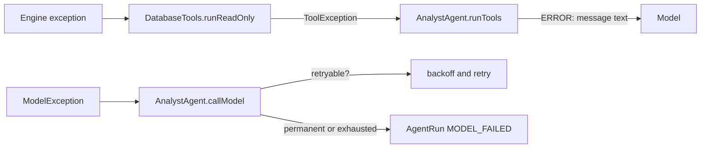

# LLD 05 - Error Model

## Hierarchy

```
RuntimeException
└── FrierenException                      engine root: "expected" failures
    ├── SchemaException                   bad row, bad schema, corrupt row bytes
    ├── StorageException                  page I/O, buffer pool, slotted page, heap file
    ├── CatalogException                  table registry problems, bad table names
    ├── SqlException                      syntax and semantic errors in SQL
    │   └── ReadOnlyViolationException    non-SELECT/EXPLAIN passed to Database.query
    ├── QueryLimitException               time or memory budget exceeded
    ├── TransactionException              misuse of BEGIN/COMMIT/ROLLBACK, DDL in a transaction, transaction rolled back
    ├── ModelException (agent)            LLM call failed; carries retryable flag
    └── ToolException (agent)             a tool call the model can fix by retrying
```

Rule: **everything the caller can reasonably handle is a `FrierenException`**. Anything else (`NullPointerException`, `IllegalStateException`, `ArithmeticException`...) indicates a bug, except argument checks that throw `IllegalArgumentException` (programmer errors: invalid `QueryOptions`, blank question).

## Who throws what

| Situation | Exception | Message style |
|---|---|---|
| `Value` comparison across types | `FrierenException` (converted to `SqlException` by the SQL layer) | `Cannot compare TEXT with INT` |
| Row has wrong arity / type / NULL in required column | `SchemaException` | `Column x does not accept NULL` |
| Corrupt row bytes | `SchemaException` | `Corrupt row data` |
| File is not whole pages, bad page id, wrong buffer size | `StorageException` | includes path and page id |
| All buffer pool frames pinned | `StorageException` | `Buffer pool exhausted: all N pages are pinned` |
| Record too large | `StorageException` | `Record of N bytes exceeds the page limit of 4088` |
| Unknown or duplicate table, invalid table name, bad catalog | `CatalogException` | `No such table: x` |
| Unknown or duplicate index, invalid index name, missing index file | `CatalogException` | `No such index: x`, `Index already exists: x` |
| `TEXT` key over 255 bytes in an indexed column; index file for another key type; bad index magic | `StorageException` | `Index key is N bytes; TEXT index keys are limited to 255 bytes` |
| Corrupt or foreign write-ahead log; log naming a file outside the directory | `StorageException` | `... is not a FrierenDB write-ahead log` |
| `BEGIN` while a transaction is open | `TransactionException` | `A transaction is already in progress` |
| `COMMIT` / `ROLLBACK` with none open | `TransactionException` | `COMMIT without BEGIN: no transaction is in progress` |
| `CREATE`/`DROP` inside a transaction | `TransactionException` | `CREATE and DROP cannot run inside a transaction; COMMIT or ROLLBACK first` |
| Statement failed after changing data inside a transaction | `TransactionException` (cause = original error) | `The statement failed after changing data, so the whole transaction was rolled back: ...` |
| Statement failed outside a transaction | the original exception | the statement was rolled back first, so nothing changed |
| Any statement after `close()` | `FrierenException` | `The database is closed` |
| Syntax error | `SqlException` | `... at position N (found 'x')` |
| Unknown/ambiguous column, bad grouping, aggregate in wrong place | `SqlException` | `Unknown column: x` |
| Integer overflow, divide by zero, bad function argument | `SqlException` | `Division by zero` |
| `Database.query` with a write, `CREATE INDEX`, or `BEGIN`/`COMMIT`/`ROLLBACK` | `ReadOnlyViolationException` | `Only SELECT and EXPLAIN statements are allowed in read-only mode` |
| Query ran too long or held too many rows | `QueryLimitException` | `Query exceeded its time limit` |
| HTTP 401/403 | `ModelException(retryable=false)` | `The model server rejected the credentials (HTTP 401)` |
| HTTP 429/5xx, network failure | `ModelException(retryable=true)` | `... unavailable or rate limiting (HTTP 503)` |
| Model sent bad tool args | `ModelException(retryable=true)` | `The model sent malformed tool arguments` |
| Tool argument missing/too long, SQL error inside a tool | `ToolException` | becomes `ERROR: <message>` for the model |

## How errors travel



- The **REPL** catches `FrierenException` and prints `Error: <message>`; other `RuntimeException`s print `Internal error: <class>: <message>` and the loop continues.
- The **agent** never lets a tool failure escape; unexpected `RuntimeException`s from tools become a generic error for the model and a detailed trace event for humans.

## Guidelines for new errors

1. Pick the narrowest existing type; add a new subclass only when a caller must react differently.
2. Include what was wrong and, for SQL, where (character position).
3. Never include secrets, file contents or stack traces in messages that reach the model or a log.
4. Every exception class needs `private static final long serialVersionUID = 1L;` (the build uses `-Xlint:all -Werror`).
